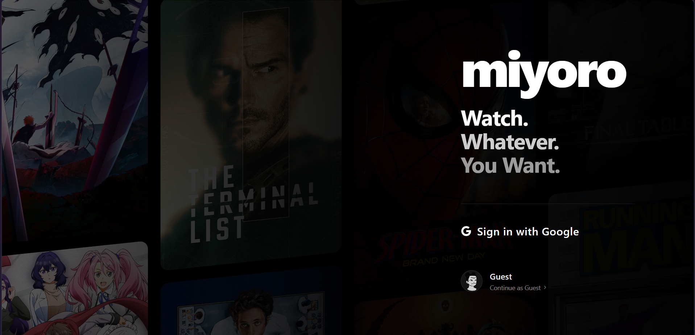
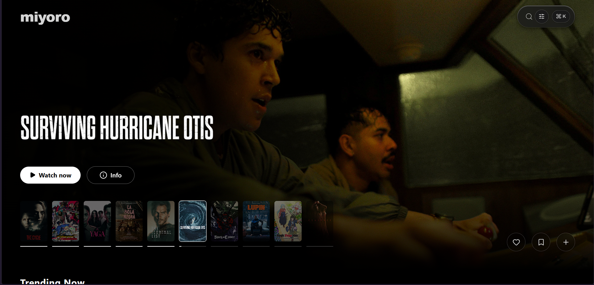
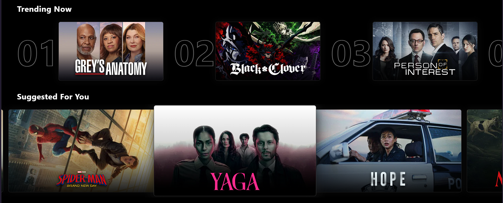

<div align="center">

# **m i y o r o**
### *Watch. Whatever. You Want.*

<p align="center">
  <a href="https://miyoro.vercel.app">
    
  </a>
  
  
</p>

<p align="center">
  
  
  
  
  
  
  
  
</p>

---

### 🌐 [**Launch Application — miyoro.vercel.app ↗**](https://miyoro.vercel.app)

</div>

<br />

## **Overview**

**Miyoro** is a minimalist, high-performance streaming and media discovery platform crafted for cinema, television, and anime. Engineered around a zero-clutter dark interface, Miyoro unifies global entertainment catalogs into a single fluid browsing and playback experience.

By pairing real-time metadata from **The Movie Database (TMDB)** with the **AniList GraphQL API** through an automated cross-ID resolution layer (**Fribb**), Miyoro bridges western cinema and seasonal anime with official studio artwork, title logos, and episode tracking.

> [!IMPORTANT]
> **Active Development & Playback Roadmap**  
> Miyoro is currently under **active development**. The media player architecture is actively being upgraded to introduce **Native Video Playback** (direct HLS/DASH streaming with custom controls, subtitle tracks, and quality switching) while **retaining standard multi-server embeds** for maximum reliability and fallback coverage.

<br />

## **Tech Stack**

<div align="center">


</div>

<br />

## **Interface Walkthrough**

### **01 — Entry & Authentication (`/`)**
The root landing experience welcomes users with an animated, multi-column floating poster wall curated from trending films and anime. Designed for zero-friction onboarding, users can authenticate via Google Sign-In or jump straight into the catalog using instant Guest access.

<p align="center">
  
</p>

<br />

### **02 — Hero Billboard & Discovery (`/home`)**
Upon entering `/home`, a full-bleed cinematic spotlight showcases top trending releases with official studio title treatment, backdrop grading, interactive poster-strip navigation, watchlist quick actions, and a minimalist top bar featuring instant `⌘K` command search.

<p align="center">
  
</p>

<br />

### **03 — Ranked Rails & Curated Collections (`/home` cont.)**
Scrolling down `/home` reveals precision-spaced horizontal carousels, starting with the outlined Top 10 Ranked Countdown followed by personalized and genre-blended rows. Every media card dynamically resolves high-contrast title logos over widescreen backdrops with smooth drag-to-scroll physics.

<p align="center">
  
</p>

<br />

## **Core Capabilities**

- **Unified Cinema & Anime Engine** — Real-time synchronization between TMDB v3 and AniList GraphQL, normalized via Fribb ID mapping so anime entries receive full widescreen backdrops, clearlogos, and season structures.
- **Hybrid Player Architecture *(In Progress)*** — Transitioning to native stream playback with custom UI controls while maintaining full support for standard embed providers.
- **Command Search (`⌘K`)** — Instant keyboard-first search modal querying movies, series, and anime simultaneously.
- **Platform Hubs** — Dedicated provider filtering across Netflix, Prime Video, Disney+, Apple TV+, Max, and Crunchyroll.
- **Fluid Spatial Rhythm** — Custom drag-scroll carousels, intersection-observed lazy logo resolution, and zero-jank route scroll restoration.

<br />

## **Local Development**

```bash
# 1. Clone repository
git clone https://github.com/your-username/miyoro.git
cd miyoro

# 2. Install dependencies
npm install

# 3. Start development server (http://localhost:3000)
npm run dev

# 4. Production build
npm run build
```

<br />

## **Architecture**

```text
miyoro/
├── 1.png / 2.png / 3.png    # Interface preview assets
├── src/
│   ├── api/                 # TMDB v3, AniList GraphQL & Fribb cross-mapping
│   ├── components/          # Hero billboard, draggable rows, navbar & player UI
│   ├── contexts/            # Firebase Auth & user session state
│   ├── hooks/               # Scroll restoration & keyboard shortcut hooks
│   └── pages/               # Landing (/), Home (/home), Watch, Player, Browse & Search
└── vite.config.ts           # Build & bundler configuration
```

<br />

<div align="center">
  <sub>Built for seamless entertainment. Powered by TMDB, AniList & Fribb.</sub>
</div>
